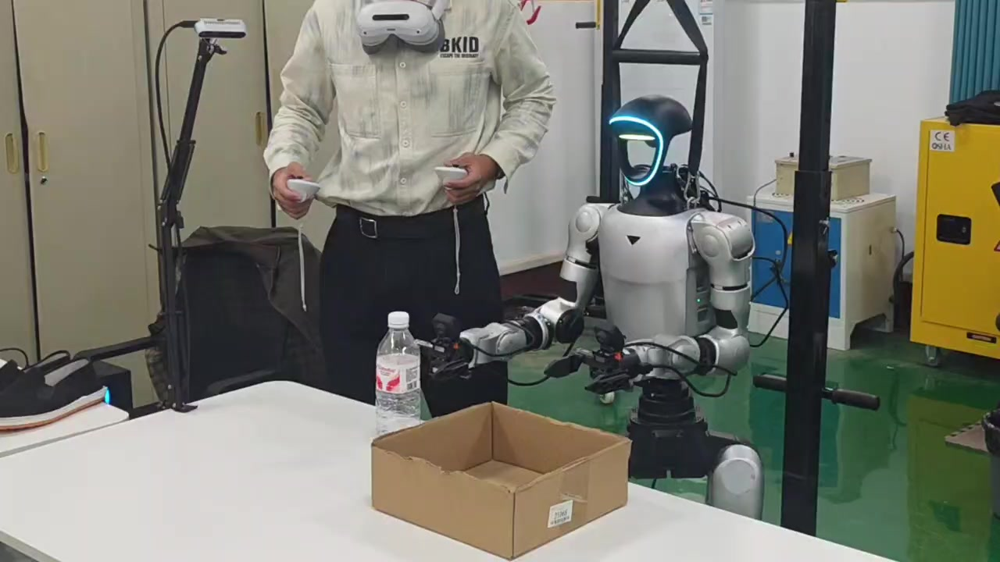
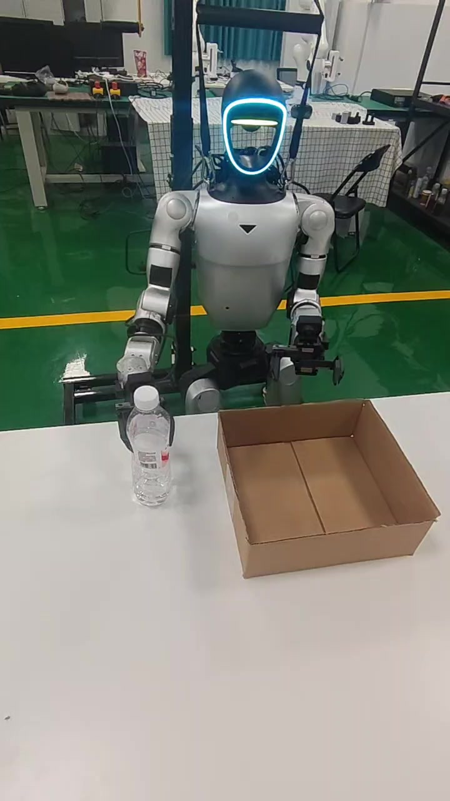
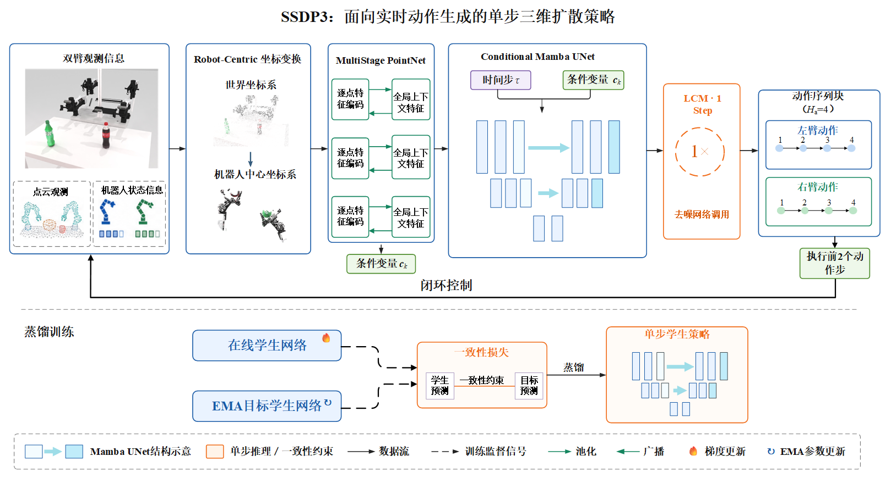
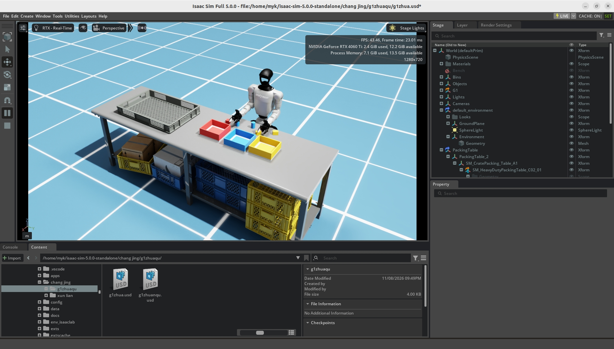

<a id="top"></a>

# Embodied AI & Robot Learning

**Robot Manipulation · Imitation Learning · 3D Diffusion Policy**

围绕机器人操作开展算法研究与工程实践，关注视觉与三维点云条件下的动作策略学习、扩散策略加速，以及真实机器人上的数据采集、训练与部署。

本作品集集中展示三个项目：Unitree G1 双臂模仿学习、SSDP3 单步三维扩散策略，以及 Isaac Sim 机器人操作场景仿真。

**项目导航：** [01 / G1 真机模仿学习](#g1) · [02 / SSDP3](#ssdp3) · [03 / Isaac Sim](#isaac-sim) · [技术技能](#skills) · [联系](#contact)

> 当前页面为作品集初稿，已接入 G1 遥操作与 ACT 自主执行视频、SSDP3 架构图和 Isaac Sim 场景截图。实验设置、指标及视频执行条件仍待核对，详见[内容核对清单](docs/publication-checklist.md)。

## Projects at a Glance

| 项目 | 研究与工程问题 | 展示重点 |
| --- | --- | --- |
| **Unitree G1 双臂模仿学习** | 如何将遥操作示范转化为可在机器人上执行的操作策略 | 三视角数据、ACT / DP / DP3、DDS 部署 |
| **SSDP3 单步三维扩散策略** | 如何减少三维扩散策略的去噪调用次数与预测耗时 | 点云表征、Conditional Mamba U-Net、一致性蒸馏 |
| **Isaac Sim 场景仿真** | 如何构建可重复重置、可检查任务判定逻辑的桌面环境 | G1 / Dex1、场景配置、物体随机化、稳定入箱判定 |

## Research Interests

- Robot Learning & Manipulation
- Imitation Learning：ACT / Diffusion Policy / DP3
- 3D Point Cloud Representation Learning
- Diffusion Policy Acceleration
- Sim-to-Real & Robot Deployment

---

<a id="g1"></a>

## 01 / Unitree G1 双臂模仿学习与真机部署

**时间：** 2026.09–2026.10  
**技术栈：** Unitree G1 / Dex1 · XR Teleoperate · LeRobot · PyTorch · ACT · Diffusion Policy · DP3 · DDS

围绕 Unitree G1 双臂机器人，搭建从遥操作示范采集、数据预处理、策略训练到真机部署的实验流程，探索视觉条件下的抓取、搬运、放置及物体传递。

### Demo Preview

| 遥操作与数据采集 | ACT 策略自主执行 |
| --- | --- |
| [](assets/g1-teleoperation.mp4) | [](assets/g1-policy-demo.mp4) |
| [观看遥操作视频 · 11.73 秒](assets/g1-teleoperation.mp4) | [观看 ACT 自主执行视频 · 8.38 秒](assets/g1-policy-demo.mp4) |
| 展示操作者控制机器人、采集示范的片段 | 展示 ACT 模仿学习策略自主执行片段，策略类型由用户确认 |

点击封面或文字链接打开对应 MP4 文件。封面取自各视频第 2 秒，视频保持原始内容与时长。

遥操作画面用于展示示范采集；策略执行画面用于展示模型行为。任务定义、是否剪辑或加速、是否存在人工干预等信息待补充，单段执行片段不代表统计成功率。

### Data → Training → Deployment

```text
XR 双臂遥操作
    ├── 三视角 RGB + 状态 / 动作 → LeRobot 数据集 → ACT / Diffusion Policy
    └── RGB-D + 状态 / 动作 → 深度反投影 → 点云采样 → Zarr → DP3
                                                                    ↓
                                      观测输入 → 动作块预测 → DDS → G1 / Dex1
```

#### 遥操作与数据准备

- 使用 XR Teleoperate 采集双臂操作示范。
- 整理 **60 条三视角 RGB 示范**，对齐图像、机器人状态及动作信息，构建 LeRobot 数据集。
- 另整理 **60 条 RGB-D 示范**，通过深度反投影生成点云，并采样为 DP3 所需的观测输入。

#### 模仿学习训练

- 使用 LeRobot 训练 ACT 与 Diffusion Policy。
- 将 RGB-D 数据整理为 Zarr 格式，适配 DP3 的点云、状态及动作输入。
- 保持训练与部署阶段的观测处理和动作维度一致。

#### 真机部署与执行分析

- 通过 DDS 向 G1 双臂及夹爪下发 **16 维位置控制指令**。
- 开展 ACT、Diffusion Policy 与 DP3 的真机策略验证。
- 结合执行日志检查观测时序、动作块调度及执行过程，并进行离线对照验证。

**后续补充：** 数据集划分、视频执行条件、各策略任务定义、试验次数、成功判据和完整尝试记录。当前不列出未经补充记录的真机成功率。

[返回顶部](#top)

---

<a id="ssdp3"></a>

## 02 / SSDP3：单步三维扩散策略

**Single-Step 3D Diffusion Policy**

**时间：** 2026.03–2026.07  
**技术栈：** PyTorch · PointNet · Mamba · Diffusion Policy · Consistency Distillation · RoboTwin  
**角色：** 第一作者 / 算法实现、训练与实验评估（按项目草稿，发布前核对）

针对三维扩散策略需要多次迭代去噪、模型预测延迟较高的问题，研究基于点云观测的单步动作生成方法，减少推理阶段的去噪网络调用次数。

### Architecture



*SSDP3 算法架构与一致性蒸馏训练示意。点击图片可查看原图。*

#### Robot-Centric Point Cloud Representation

将点云转换至机器人基座坐标系，采用多阶段 PointNet 提取三维几何特征，为动作策略提供空间观测表征。

#### Conditional Mamba U-Net

构建条件动作生成网络，融合视觉观测与机器人状态信息，建模动作序列特征。

#### Teacher–Student Consistency Distillation

采用教师—学生一致性蒸馏，将动作生成时的去噪网络调用次数从 **10 次减少至 1 次**。

### Experimental Results

以下为项目草稿中的结果，待补齐实验设置与原始记录后用于正式发布。

| 指标 | 草稿记录 | 统计或计时范围 |
| --- | --- | --- |
| RoboTwin 六任务平均成功率 | **70.3%** | 待补任务名单、每任务试验次数及汇总方式 |
| 模型侧单次动作预测耗时 | **8.45 ms** | 模型侧预测；待补硬件、批量大小、精度及计时方法 |
| 去噪网络调用次数 | **1 次** | 蒸馏后策略的动作生成阶段 |
| 真实机器人验证平台 | **Franka Research 3** | 待补任务设置及视频 |

**计时口径：** 8.45 ms 不包含视觉采集、通信及机器人实际执行时间；该数值不能直接换算为机器人的实际控制频率。

### Real-Robot Validation

项目草稿记录了在 **Franka Research 3** 上开展双瓶抓取与双鞋放置任务验证。对应任务设置、执行视频及统计结果待补充。

### Research Status

论文《SSDP3》相关成果按现有草稿处于审稿中，具体状态待发布前核对。完整实现与补充实验材料根据论文进展和公开许可情况更新。

[返回顶部](#top)

---

<a id="isaac-sim"></a>

## 03 / Isaac Sim 机器人操作场景仿真

**时间：** 2026.07–2026.08  
**技术栈：** NVIDIA Isaac Sim · Python · Robot Simulation

使用 Isaac Sim 搭建机器人桌面操作环境，开展场景配置、物体运动及任务判定逻辑验证。



*Isaac Sim 桌面操作场景截图；场景画面用于展示环境搭建。*

- 配置固定底座 Unitree G1 / Dex1 模型。
- 搭建包含工作台、刚体物品和目标料格的桌面分拣场景。
- 实现物体位姿随机重置及稳定入箱判定。
- 开展差速移动平台控制仿真实验，验证手柄指令到轮速控制的基本流程。

**验证范围：** 场景、随机重置及任务判定逻辑的验证；自主抓取或学习策略成功率需另附独立实验记录。

[返回顶部](#top)

---

<a id="skills"></a>

## Technical Skills

| 方向 | 技术 |
| --- | --- |
| Programming | Python · PyTorch · Linux |
| Robot Learning | ACT · Diffusion Policy · DP3 |
| 3D Vision | RGB-D · Point Cloud · PointNet |
| Robot Platforms | Unitree G1 / Dex1 · Franka Research 3 |
| Simulation | NVIDIA Isaac Sim |
| Deployment & Data | XR Teleoperate · LeRobot · DDS · Zarr |

<a id="contact"></a>

## Contact

**Research Focus：** Embodied AI / Robot Learning / Manipulation  
**Email：** [18236783982@163.com](mailto:18236783982@163.com)

本页面持续整理个人研究与工程实践成果。

---

**维护说明：** [图片与视频素材准备](assets/README.md) · [发布前核对清单](docs/publication-checklist.md)
