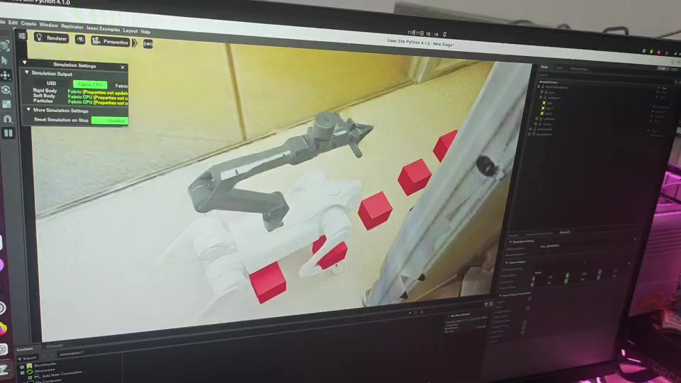
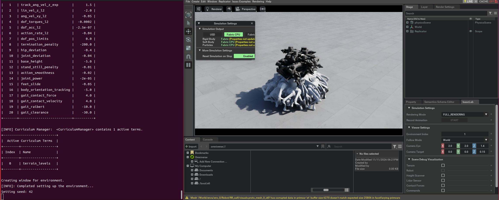

<a id="top"></a>

# Embodied AI & Robot Learning

**孟亚坤 · 具身智能算法实习 · 机器人操作 / 模仿学习**

**Robot Manipulation · Imitation Learning · 3D Diffusion Policy · Reinforcement Learning**

围绕机器人操作与运动控制开展算法研究及工程实践，关注视觉与三维点云条件下的动作策略学习、扩散策略加速、强化学习运动控制，以及真实机器人上的数据采集、训练与部署。

本作品集集中展示四个项目：Unitree G1 双臂模仿学习、SSDP3 单步三维扩散策略、Go2 搭载机械臂的强化学习运动控制，以及 Isaac Sim 机器人操作场景仿真。

**项目导航：** [01 / G1 真机模仿学习](#g1) · [02 / SSDP3](#ssdp3) · [03 / Go2 + 机械臂 PPO](#go2-ppo) · [04 / Isaac Sim](#isaac-sim) · [技术技能](#skills) · [联系](#contact)

**展示内容：** G1 真机遥操作与 ACT 自主执行、SSDP3 算法结构与实验结果、Go2 强化学习仿真行走，以及 Isaac Sim 桌面操作场景。

## Projects at a Glance

| 项目 | 研究与工程问题 | 展示重点 |
| --- | --- | --- |
| **Unitree G1 双臂模仿学习** | 如何将遥操作示范转化为可在机器人上执行的操作策略 | 三视角数据、ACT / DP / DP3、DDS 部署 |
| **SSDP3 单步三维扩散策略** | 如何减少三维扩散策略的去噪调用次数与预测耗时 | 点云表征、Conditional Mamba U-Net、一致性蒸馏 |
| **Go2 + 机械臂强化学习运动控制** | 如何在机械臂保持固定姿态时训练四足行走策略 | PPO、稳定行走、给定路径跟踪、仿真验证 |
| **Isaac Sim 场景仿真** | 如何构建可重复重置、可检查任务判定逻辑的桌面环境 | G1 / Dex1、场景配置、物体随机化、稳定入箱判定 |

## Research Interests

- Robot Learning & Manipulation
- Imitation Learning：ACT / Diffusion Policy / DP3
- 3D Point Cloud Representation Learning
- Diffusion Policy Acceleration
- Reinforcement Learning & Quadruped Locomotion
- Sim-to-Real & Robot Deployment

---

<a id="g1"></a>

## 01 / Unitree G1 双臂模仿学习与真机部署

**时间：** 2026.09–2026.10  
**技术栈：** Unitree G1 / Dex1 · XR Teleoperate · LeRobot · PyTorch · ACT · Diffusion Policy · DP3 · DDS

围绕 Unitree G1 双臂机器人，搭建从遥操作示范采集、数据预处理、策略训练到真机部署的实验流程，探索视觉条件下的抓取、搬运、放置及物体传递。

### Demo Preview

| 遥操作与数据采集 | ACT 策略自主执行 |
| --- | --- |
| [](assets/g1-teleoperation.mp4) | [](assets/g1-policy-demo.mp4) |
| [观看遥操作视频 · 11.73 秒](assets/g1-teleoperation.mp4) | [观看 ACT 自主执行视频 · 8.38 秒](assets/g1-policy-demo.mp4) |
| 展示操作者控制机器人、采集示范的片段 | 展示 ACT 模仿学习策略自主执行片段 |

点击封面或文字链接打开对应 MP4 文件。封面取自各视频第 2 秒，视频保持原始内容与时长。

遥操作视频展示示范采集过程，ACT 视频展示策略自主执行片段。真机测试结果见下方评估表。

### Data → Training → Deployment

```text
XR 双臂遥操作
    ├── 三视角 RGB + 状态 / 动作 → LeRobot 数据集 → ACT / Diffusion Policy
    └── RGB-D + 状态 / 动作 → 深度反投影 → 点云采样 → Zarr → DP3
                                                                    ↓
                                      观测输入 → 动作块预测 → DDS → G1 / Dex1
```

#### 遥操作与数据准备

- 使用 XR Teleoperate 采集双臂操作示范。
- 整理 **60 条三视角 RGB 示范**，对齐图像、机器人状态及动作信息，构建 LeRobot 数据集。
- 另采集 **60 条 RGB-D 示范**，通过深度反投影生成相机坐标系点云，采样至 **512 点**并整理为 Zarr，适配 DP3 观测输入。

#### 模仿学习训练

- 使用 LeRobot 训练 ACT 与 Diffusion Policy。
- 将 RGB-D 数据整理为 Zarr 格式，适配 DP3 的点云、状态及动作输入。
- 保持训练与部署阶段的观测处理和动作维度一致。

#### 真机部署与执行分析

- 通过 DDS 向 G1 双臂及夹爪下发 **16 维位置控制指令**。
- 开展 ACT、Diffusion Policy 与 DP3 的真机策略验证。
- 从执行日志发现 DP3 观测间隔偏离训练节奏、轨迹逐目标重置的问题，调整动作块调度，并用离线对照检查修复结果。

### Real-Robot Evaluation

在 Unitree G1 / Dex1 上对每种策略各进行 **50 次真机测试**。

| 策略 | 测试任务 | 真机测试次数 | 成功率 |
| --- | --- | --- | --- |
| ACT | 瓶体抓取、搬运与入盒 | 50 次 | **42%** |
| Diffusion Policy | 瓶体抓取、搬运与入盒 | 50 次 | **54%** |
| DP3 | 双臂瓶体传递 | 50 次 | **28%** |

ACT、DP 与 DP3 的结果对应表中任务，其中 DP3 使用不同任务，不将三者的成功率作为同一任务下的直接排名。[实验结果与评估说明](docs/experiments.md)

[返回顶部](#top)

---

<a id="ssdp3"></a>

## 02 / SSDP3：单步三维扩散策略

**Single-Step 3D Diffusion Policy**

**时间：** 2025.12–2026.06  
**技术栈：** PyTorch · PointNet · Mamba · Diffusion Policy · Consistency Distillation · RoboTwin  
**角色：** 第一作者 / 算法实现、训练与实验评估

针对三维扩散策略需要多次迭代去噪、模型预测延迟较高的问题，研究基于点云观测的单步动作生成方法，减少推理阶段的去噪网络调用次数。

### Architecture


*SSDP3 算法架构与一致性蒸馏训练示意。点击图片可查看原图。*

#### Robot-Centric Point Cloud Representation

将点云转换至机器人基座坐标系，采用三阶段 PointNet 提取三维几何特征，为动作策略提供空间观测表征。

#### Conditional Mamba U-Net

构建条件动作生成网络，融合视觉观测与机器人状态信息，建模动作序列特征。

#### Teacher–Student Consistency Distillation

采用教师—学生一致性蒸馏，将动作生成时的去噪网络调用次数从 **10 次减少至 1 次**。

### Experimental Results

在 **RoboTwin 2.0 六项双臂仿真任务**上，与 10 步 DP3 对比：

| 指标 | 10 步 DP3 | SSDP3 |
| --- | --- | --- |
| 六任务平均成功率 | 52.9% | **70.3%** |
| 模型侧单次动作预测耗时 | 121.31 ms | **8.45 ms** |
| 去噪网络调用次数 | 10 次 | **1 次** |

**计时口径：** 8.45 ms 不包含视觉采集、通信及机器人实际执行时间；该数值不能直接换算为机器人的实际控制频率。

### Real-Robot Validation

在 **Franka Research 3** 上完成双瓶抓取与双鞋放置任务验证。该平台验证与 RoboTwin 2.0 六任务仿真统计分别描述，不合并为同一成功率指标。

### Research Status

相关论文为第一作者成果，目前在《计算机工程与应用》二审中。完整实现与补充实验材料根据论文进展和公开许可情况更新。

[返回顶部](#top)

---

<a id="go2-ppo"></a>

## 03 / Go2 搭载机械臂的强化学习运动控制

**时间：** 2026.07–2026.08  
**技术栈：** PPO · Isaac Sim · Unitree Go2 · Reinforcement Learning

### 项目介绍

- 基于 Isaac Sim 构建 Go2 搭载机械臂的仿真环境，使用 PPO 训练机械臂保持固定姿态时的四足行走策略。
- 在仿真中实现搭载机械臂条件下的稳定行走与给定路径跟踪，完成策略训练及行走效果验证。

### Simulation Demo

[](assets/go2-arm-ppo-demo.mp4)

[观看 Go2 + 机械臂仿真行走视频 · 60.84 秒](assets/go2-arm-ppo-demo.mp4)

*封面取自视频第 20 秒的仿真画面，视频保持原始内容与时长。*

### 训练环境截图



**任务设定：** 机械臂保持固定姿态，由 PPO 策略完成四足运动控制。验证范围为 Isaac Sim 仿真中的行走与路径跟踪。

[返回顶部](#top)

---

<a id="isaac-sim"></a>

## 04 / Isaac Sim 机器人操作场景仿真

**时间：** 2026.06–2026.08  
**技术栈：** NVIDIA Isaac Sim · Python · Robot Simulation

使用 Isaac Sim 搭建机器人桌面操作环境，开展场景配置、物体运动及任务判定逻辑验证。


*Isaac Sim 桌面操作场景截图；场景画面用于展示环境搭建。*

- 配置固定底座 Unitree G1 / Dex1 模型。
- 搭建包含工作台、刚体物品和目标料格的桌面分拣场景。
- 实现物体位姿随机重置及稳定入箱判定。
- 搭建手柄触发的小车动作块，通过差速控制器驱动左右轮，并验证运动响应。

**验证范围：** 场景搭建、物体随机重置、稳定入箱判定，以及手柄触发的小车运动响应。

[返回顶部](#top)

---

<a id="skills"></a>

## Technical Skills

| 方向 | 技术 |
| --- | --- |
| Programming | Python · PyTorch · Linux |
| Robot Learning | ACT · Diffusion Policy · DP3 |
| Reinforcement Learning | PPO · Quadruped Locomotion |
| 3D Vision | RGB-D · Point Cloud · PointNet |
| Robot Platforms | Unitree G1 / Dex1 · Unitree Go2 · Franka Research 3 |
| Simulation | NVIDIA Isaac Sim |
| Deployment & Data | XR Teleoperate · LeRobot · DDS · Zarr |

<a id="contact"></a>

## Contact

**Research Focus：** Embodied AI / Robot Learning / Manipulation  
**Email：** [18236783982@163.com](mailto:18236783982@163.com)

本页面持续整理个人研究与工程实践成果。

## Code Availability

[查看 SSDP3 目录骨架](ssdp3/)

本仓库用于展示项目方法、实验结果及演示素材。`ssdp3/` 为工程目录骨架，文件为空占位，不包含可运行实现、模型权重或有效数据；完整研究代码尚未公开。

---

**补充资料：** [实验结果与评估说明](docs/experiments.md) · [图片与视频素材](assets/README.md)
